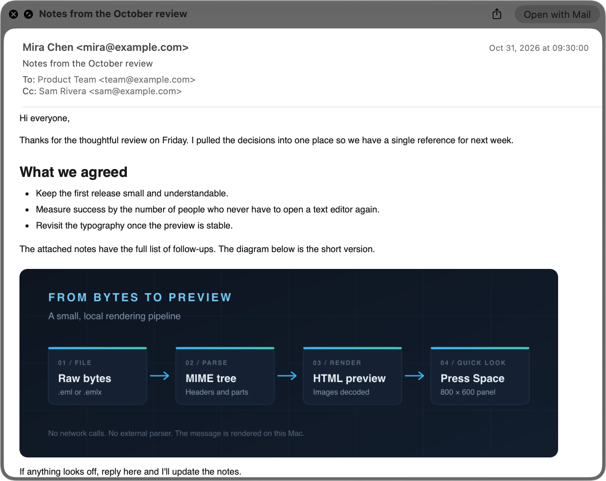
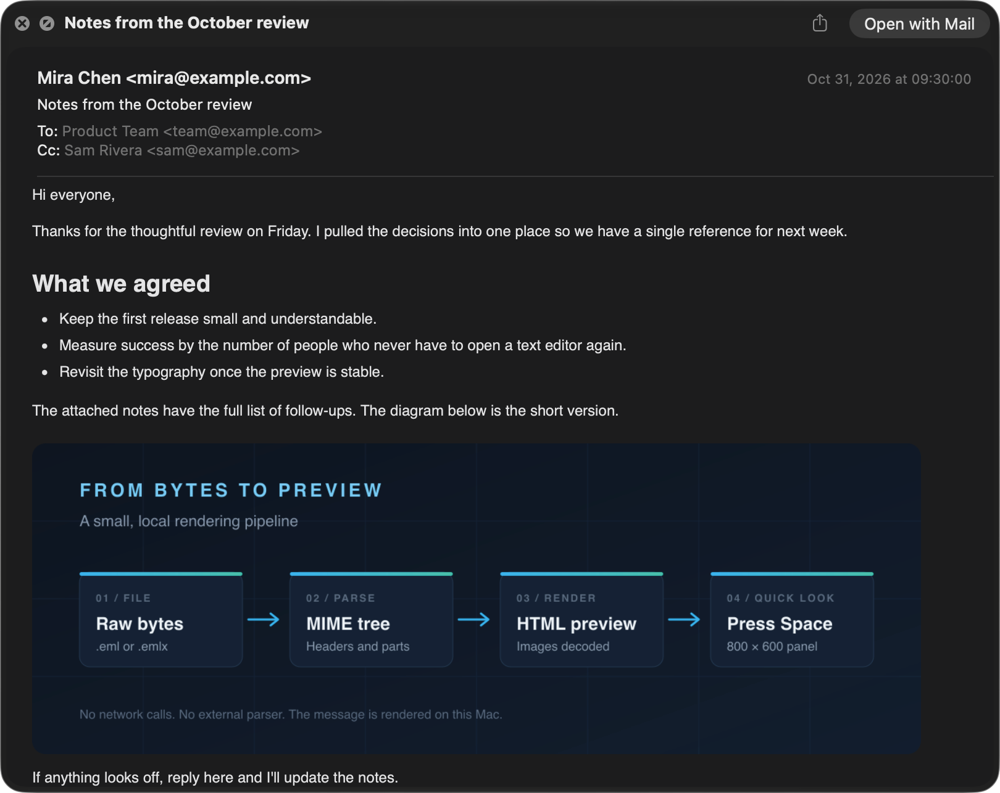

<p align="center">
  
</p>

<h1 align="center">EML Quick Look</h1>

<p align="center">
  A drop-in Quick Look replacement for <code>.eml</code> and <code>.emlx</code> files on macOS.<br>
  It parses and renders the message itself, so valid mail no longer previews as a blank page.
</p>

<p align="center">
  <a href="https://github.com/gonejack/EMLQuickLook/releases/latest"></a>
  
  
</p>

## The at least five-year bug

Apple Mail's Quick Look preview has a long-standing defect: a valid,
standards-compliant `.eml` file can open to a blank panel or a header-only panel, even
though the message is perfectly readable in other mail clients. The file is not damaged.
It uses the RFC 5322 CRLF line-ending convention that `.eml` files are supposed to use.

The fault is in Apple's parser. Mail's Quick Look extension passes the raw file to:

```objc
[MCMessage messageWithRFC822Data:data sanitizeData:NO];
```

For an affected CRLF message, that call can return zero MIME subparts. With no body in
the parse result, the preview has nothing to show.

I first ran into this bug and reported it to Apple five years ago; no macOS release since
has fixed it. In my experience it is at least five years old, and possibly more than ten.
EML Quick Look exists so that waiting for a fix is optional.

## A seamless replacement

EML Quick Look is meant to disappear into Quick Look, not become another app you have to
remember. Select an `.eml` or `.emlx` file in Finder, press Space, and read the message.
There is no import step, no conversion, and no companion window to keep open. It replaces
Apple Mail's Quick Look previewer, not Mail itself; the files, the Mail library, and the
**Open with Mail** action are untouched.

The presentation is deliberately matched to Mail's Quick Look: the 800 × 600 panel, the
sender/date/subject/recipient header, 12px Helvetica body type, link colors, and the light
and dark appearance treatments. HTML bodies keep their own fonts and sizing. In dark mode,
the body follows Mail's inversion while images keep their original colors.

Under the hood, the extension bypasses `MCMessage` entirely. It normalizes line endings,
parses the MIME tree, decodes the body and inline images, and returns a complete HTML
preview to Quick Look.

## Screenshots

Light and dark appearance, generated from the synthetic message in
[`docs/example.eml`](docs/example.eml). The message uses `example.com` addresses and a
locally generated inline image.

| Light | Dark |
|:---:|:---:|
|  |  |

## Features

**Message support**

- `.eml` and Apple Mail `.emlx` files
- CRLF, LF, and mixed line endings
- base64 and quoted-printable transfer encodings
- charset detection from the declared charset, HTML `<meta>` charset, UTF-8, GB18030,
  and Windows-1252 fallbacks
- RFC 2047 encoded headers (`=?UTF-8?B?...?=`)
- `multipart/alternative`, `multipart/related`, and `multipart/mixed`
- inline `cid:` images embedded as `data:` URLs
- Apple Mail "share page" exports made of a sequence of HTML fragments and images,
  concatenated into one article

**Presentation**

- a Mail-style header with sender, date, subject, and recipients, using Mail's header type
  sizes, colors, and spacing
- a preview title taken from the message subject, falling back to the file name
- an 800 × 600 preview laid out to Mail's page geometry
- Mail's 12px Helvetica base typography for HTML bodies, with the message's own fonts and
  sizes still taking precedence
- automatic light and dark appearance matching Mail's Quick Look, including Mail's
  dark-mode body inversion with images left unchanged
- readable plain-text rendering when there is no HTML body
- an attachment list with file names and sizes

**Safety**

- scripts, iframes, objects, embeds, meta-refresh tags, inline event handlers, and
  `javascript:` URLs are removed from HTML
- a restrictive Content-Security-Policy
  (`script-src 'none'; object-src 'none'; frame-src 'none';`) is added
- remote images are not blocked, matching Mail; see
  [Privacy and security](#privacy-and-security)

## How it works

1. Quick Look hands the file URL to `PreviewProvider`.
2. `.emlx` envelopes are unwrapped, line endings are normalized, and the headers and MIME
   parts are parsed.
3. Transfer encodings, charsets, and RFC 2047 headers are decoded.
4. The renderer selects the HTML body (or plain text), rewrites `cid:` images as `data:`
   URLs, sanitizes the HTML, and adds a Mail-style header.
5. `QLPreviewReply` returns an 800 × 600 HTML preview.

Parsing happens locally; the extension never calls Mail's parser, so the `MCMessage` bug
cannot affect the result.

## Requirements

- macOS 14 or later
- Apple Silicon (the build script targets `arm64-apple-macosx14.0`)
- Xcode Command Line Tools (`xcrun swiftc`, `codesign`) when building from source

The app is ad-hoc signed. That is enough for local use, but a Developer ID-signed extension
from another app can take precedence for the same content type. In that case, disable the
competing extension with `pluginkit`.

## Download

Prebuilt releases are available on the
[releases page](https://github.com/gonejack/EMLQuickLook/releases/latest). Each release
includes an `EMLQuickLook-<version>-macos-arm64.zip` archive and a matching `.sha256`
checksum.

## Install

### From a release

1. Download and unzip `EMLQuickLook-*-macos-arm64.zip`. To verify the download first:

   ```sh
   shasum -a 256 -c EMLQuickLook-*-macos-arm64.zip.sha256
   ```

2. Move `EMLQuickLook.app` to `~/Applications`.
3. Open it once so Launch Services registers the extension. The app is only a host for the
   extension; it does not need to stay open.
4. Elect the extension and disable Mail's previewer:

   ```sh
   pluginkit -e use -i com.youi.EMLQuickLook.Extension
   pluginkit -e ignore -i com.apple.mail.MailQuickLookExtension
   qlmanage -r
   qlmanage -r cache
   killall quicklookd
   ```

The release is ad-hoc signed, not notarized. If macOS blocks the first launch, right-click
the app and choose **Open**, or clear the quarantine flag:

```sh
xattr -dr com.apple.quarantine ~/Applications/EMLQuickLook.app
```

### From source

```sh
git clone https://github.com/gonejack/EMLQuickLook.git
cd EMLQuickLook
./install.sh
```

`install.sh` builds the app, copies it to `~/Applications`, registers it with Launch
Services and `pluginkit`, disables Apple Mail's Quick Look extension, and resets the Quick
Look cache. Use `./install.sh --no-build` to install an existing
`build/EMLQuickLook.app` without rebuilding.

Disabling Mail's extension is required because Quick Look has no documented
per-content-type extension precedence. With both enabled, Mail's extension is selected for
`com.apple.mail.email` and the CRLF bug remains. This is the one extra step the installer
has to perform; after it, the preview is a drop-in replacement.

Open the app once if Finder does not pick up the extension immediately.

## Build

```sh
./build.sh
```

This creates:

- `build/EMLQuickLook.app` — host app with the Quick Look extension
- `build/emlrender` — command-line renderer that writes the preview HTML

The host app icon is drawn by `Tools/makeicon.swift`, packaged into
`Resources/AppIcon.icns` by `icon.sh`, and regenerated automatically when the source or the
`.icns` is out of date.

## Verify

Select an `.eml` file in Finder and press Space. The first preview can take a moment while
the extension starts.

Render a file without Quick Look:

```sh
./build/emlrender docs/example.eml /tmp/preview.html
open /tmp/preview.html
```

The `emlrender` output reports the parsed title, body type, and number of embedded images.
For example, using the synthetic message from the screenshots:

```
input bytes:   108432
message bytes: 108432
title:         Notes from the October review
summary:       html body, 1 inline image(s)
html bytes:    106844
output:        /tmp/preview.html
```

`qlmanage -p` is not a reliable test on every macOS build; if it crashes or shows a blank
panel, use Finder or the included host app:

```sh
open ~/Applications/EMLQuickLook.app --args --preview "$PWD/docs/example.eml"
```

Follow the extension log with:

```sh
log stream --level debug --predicate 'subsystem == "com.youi.EMLQuickLook"'
```

## Troubleshooting

If the old preview is still shown, reset Quick Look and restart it:

```sh
qlmanage -r
qlmanage -r cache
killall quicklookd
```

Check which extensions are elected:

```sh
pluginkit -m -A -D -v -p com.apple.quicklook.preview \
    | grep -iE 'MailQuickLook|EMLQuickLook'
```

A `+` means enabled, `-` means disabled. The custom extension should be `+` and
`com.apple.mail.MailQuickLookExtension` should be `-`.

If the extension does not appear in the list, re-register it and open the host app once:

```sh
pluginkit -a "$HOME/Applications/EMLQuickLook.app/Contents/PlugIns/EMLQuickLookExtension.appex"
open "$HOME/Applications/EMLQuickLook.app"
```

If another Developer ID-signed previewer wins for `.eml` or `.emlx`, find its identifier
and disable it:

```sh
pluginkit -m -A -D -v -p com.apple.quicklook.preview
pluginkit -e ignore -i <identifier>
```

To re-enable Mail's extension:

```sh
pluginkit -e use -i com.apple.mail.MailQuickLookExtension
```

## Privacy and security

The extension is sandboxed and reads only the file Quick Look hands it. It contains no
analytics, telemetry, or network code, and it never modifies the message.

HTML is sanitized before display: scripts, iframes, objects, embeds, meta-refresh tags,
inline event handlers, and `javascript:` URLs are removed, and a restrictive CSP disables
script, object, and frame execution. This is defense-in-depth, not a guarantee that
arbitrary HTML is safe.

Remote images are intentionally not blocked, matching Mail, so a message can still load
tracking pixels. The extension itself does not fetch them; Quick Look's web view does.
Treat an untrusted message with the same caution you would in Mail.

## Limitations

- This is a previewer, not a mail client. Reply, forward, and attachment saving still happen
  in Mail.
- Remote images can load, so tracking pixels may fire.
- Releases are arm64-only and ad-hoc signed.
- Quick Look has no documented per-content-type precedence, so Mail's previewer must be
  disabled during installation.

## Uninstall

```sh
./uninstall.sh
```

This removes `~/Applications/EMLQuickLook.app`, unregisters the extension, re-enables Mail's
Quick Look extension, and resets the Quick Look cache.

## Layout

```
Extension/
  PreviewProvider.swift   QLPreviewProvider that returns HTML data
  MIMERenderer.swift      MIME parser, decoders, charset and header handling
  HTMLRenderer.swift      body selection, image embedding, sanitization, Mail-style CSS
  Info.plist              declares com.apple.mail.email and com.apple.mail.emlx
  Extension.entitlements  sandbox and read-only file access
Host/
  main.swift              QLPreviewPanel test harness
Tools/
  main.swift              emlrender CLI
  snapshot.swift          WKWebView PNG snapshot helper
  makeicon.swift          draws the app icon artwork
Resources/
  AppIcon.icns            generated app icon
  AppIcon-1024.png        README icon
docs/
  example.eml             synthetic message used for the screenshots
  screenshots/            light and dark Quick Look screenshots
build.sh                  builds and ad-hoc signs everything
icon.sh                   renders and packages the app icon
install.sh                installs and elects the extension
uninstall.sh              removes it and restores Mail's extension
```

## Design notes

### Why not re-render through Mail's extension?

Passing a temporary `.emlx` file back to Quick Look via `QLPreviewReply(fileURL:)` does not
invoke another preview extension. Quick Look renders the referenced file with a built-in
generator, so the nested approach cannot reuse Mail's renderer. Producing the HTML directly
in this extension is the dependable route.

### Why disable Apple Mail's extension?

Quick Look has no documented per-content-type extension precedence. With both extensions
enabled, `com.apple.mail.MailQuickLookExtension` wins for `com.apple.mail.email`, so this
extension would never be selected. `install.sh` disables Mail's previewer; `uninstall.sh`
restores it.
